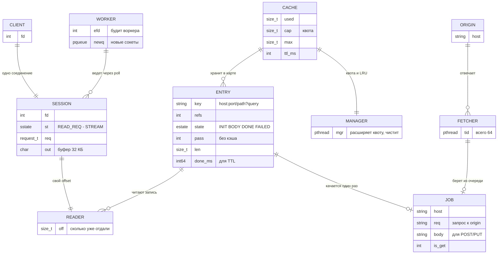

# Прокси

./proxy --port 8080 --max-client-threads 4 --cache-ttl 5

- `main` принимает соединения и раздает их воркерам по кругу.
- Воркер держит много сессий на одном poll().
- Если ресурса нет в кэше, воркер создает запись и кладет задание в очередь.
- Fetcher берет задание, качает с origin и складывает в запись.
- Все клиенты, которые ждут этот URL, читают одну запись со своего `offset`. Запрос к origin один на всех.

## 3. Схема архитектуры (воронья лапка)



## 4. Файловая структура

```text
proxy/
 ├─ Makefile
 ├─ README.md
 ├─ src/
 │   ├─ main.c
 │   ├─ worker.c
 │   ├─ fetcher.c
 │   ├─ cache.c / cache.h
 │   ├─ http.c / http.h
 │   ├─ pqueue.c / pqueue.h
 │   ├─ log.c / log.h
 │   ├─ proxy.h
 │   └─ common.h
 └─ tests/
     ├─ run_tests.sh, regress.sh, stress.sh
     └─ origin.py, evil_origin.py
```
## 5. Цепочки вызовов

### Запуск и остановка

```text
main
 ├─ getopt_long -> parse_int / parse_size
 ├─ pthread_sigmask, signalfd
 ├─ eventfd (stop_fd)
 ├─ cache_create -> cache_start -> mgr_main
 ├─ pqueue_create (очередь заданий)
 ├─ worker_create -> worker_start -> worker_main      (N штук)
 ├─ pthread_create -> fetcher_main                   (64 штуки)
 ├─ socket, setsockopt, bind, listen
 ├─ цикл: poll -> accept4 -> worker_submit
 │                          └─ если не вышло -> reply_503
 └─ остановка
     ├─ eventfd_write(stop_fd)
     ├─ worker_join
     ├─ pqueue_close -> pthread_join(fetcher'ы)
     ├─ cache_stop
     └─ job_destroy, worker_destroy, cache_destroy
```

### Воркер

```text
worker_main
 ├─ poll (efd, stop_fd, сокеты сессий)
 ├─ adopt                                  новый сокет -> сессия
 ├─ s_on_readable
 │   ├─ recv, memmem (ищем конец заголовков)
 │   ├─ s_parse
 │   │   ├─ http_parse_request
 │   │   └─ s_dispatch
 │   │       ├─ cache_acquire
 │   │       ├─ http_build_upstream
 │   │       └─ pqueue_try_add (в очередь заданий)
 │   └─ s_advance
 ├─ s_advance
 │   ├─ s_flush -> send
 │   ├─ entry_get_head
 │   ├─ entry_pull
 │   └─ s_close -> entry_release
 └─ s_error -> http_build_error
```

### Fetcher

```text
fetcher_main
 ├─ pqueue_get
 ├─ fetch
 │   ├─ connect_origin
 │   │   ├─ getaddrinfo
 │   │   ├─ socket
 │   │   ├─ connect
 │   │   ├─ wait_fd -> poll
 │   │   └─ getsockopt
 │   ├─ send_all -> send / wait_fd
 │   ├─ recv заголовков / wait_fd
 │   ├─ http_parse_response
 │   ├─ entry_prepare_known или entry_make_pass
 │   ├─ entry_set_headers
 │   ├─ entry_append (много раз)
 │   │   └─ cache_reserve -> будит mgr_main
 │   └─ entry_finish или entry_fail
 └─ job_destroy
     └─ entry_release
```

### Manager кэша

```text
mgr_main
 ├─ sweep_expired -> drop_entry
 ├─ квота мала -> cap * 2 (до max)
 ├─ evict_one -> drop_entry -> map_remove / entry_free
 └─ broadcast(space_cv)    будит fetcher'ов
```

